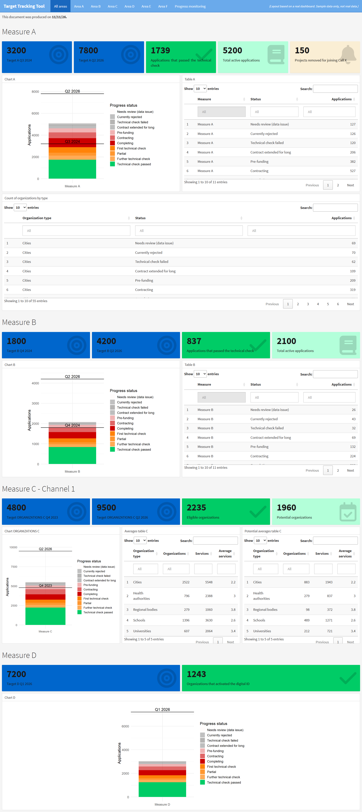

# 2 · Target tracking dashboard

**R Markdown / flexdashboard** that tracks progress towards the targets of a national public-sector programme, for the whole country and for each of its six territorial areas.

> Anonymized and generalized version of a dashboard used in production. No data is included. Measures, areas, statuses and column names are generic, and **all target values are placeholders**. See the [main README](../README.md).

---

## The problem

Public bodies apply for funding under several measures. Each measure has national targets with deadlines, and the programme team needs to know, for each measure and area:

- how many applications or organizations count towards the target;
- where each of them stands in a long process (funding, contracting, implementation, technical check);
- what is at risk (long contract extensions, rejected applications, data inconsistencies).

The information is spread across **several CRM exports**: organizations, applications, requested services, activated services, rejected applications, project dates.

## What the dashboard does

1. **Reads and filters the sources**: only legally active organizations and live applications, with clear rules for edge cases (e.g. local offices not in the organization registry).
2. **Classifies every application** into one of eleven progress statuses with a single `case_when()`. Anything that matches no rule goes to **"Needs review (data issue)"**, so no record disappears silently.
3. **Applies the counting rule of each measure**: services migrated vs not migrated, baseline vs new organizations, eligibility through funded applications, potential vs activated services, exclusion of projects already counted under another measure.
4. **Splits each national target across the six areas** in proportion to each area's target population, and **tests** that the area populations and area targets add up to the national figures.
5. **Exports contradictory records.** When two counting methods disagree, the applications concerned go to an Excel file for checking.
6. **Displays** one page per area plus a national page: target value boxes, stacked bar charts against the target lines, filterable tables, and a page on processing times (funding → contract → technical check → payment) by funding window.

## Technical choices

- **Reusable functions** for the parts repeated for every measure and area: `count_population()`, `split_target()` (both with built-in consistency tests), `plot_progress()` and `service_averages()`. The pages themselves stay explicit: in flexdashboard they are layout, and keeping them explicit makes each page easy to read and adjust.
- **Tests inside the pipeline.** `stop()` halts the build if the areas do not add up to the national total (with a ±2 tolerance for rounding), so a wrong figure never reaches the published dashboard.
- **One status vocabulary and one colour scale** across all measures, shared by charts and legends.

## Requirements

R with `tidyverse`, `flexdashboard`, `DT`, `readxl`, `openxlsx`, `lubridate`, plus [`helpers.R`](../helpers.R) for the chart theme.
