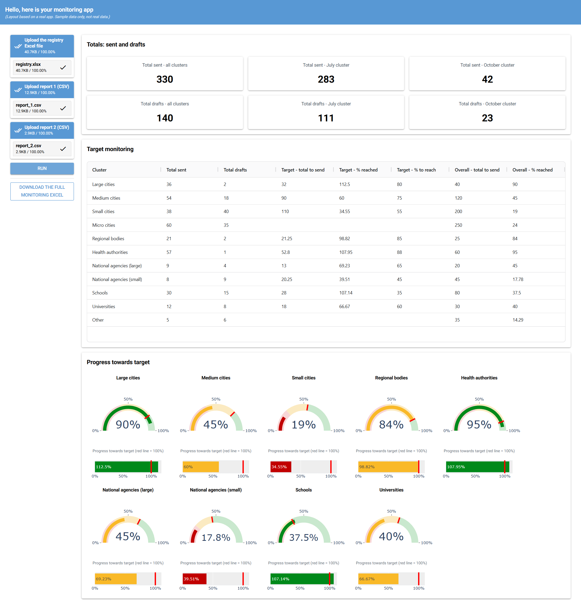

# 3 · Submission monitoring app

Monitoring of a **national online survey** that hundreds of public bodies must fill in. The same logic is available as an **R script** and as a **Python desktop app** with file upload, progress gauges and Excel download.

> Anonymized and generalized version of a tool used in production. No data is included. Clusters, column names and labels are generic, and **target values are placeholders**. See the [main README](../README.md).

---

## The problem

Each body belongs to a cluster (large cities, health authorities, schools…), and each cluster has a target: the share of its bodies that must submit the survey by a deadline (July or October). The team following the survey needs to know, at any moment:

- which bodies have sent the survey, which are still in draft and which never opened it;
- how each cluster and each area is doing against its target;
- when each body was last contacted.

The information comes from three sources: a **registry** Excel file kept by the team and two **CRM exports** (survey status, contact log).

## What it does

1. **Registry:** reads the list of bodies and moves those exempt from the survey to the "Other" cluster. The exemption column is filled in by hand, so several spellings are accepted.
2. **Survey status:** when a body has more than one record, it keeps the **most advanced status** (ordered factor: Not started < Draft < Sent). Bodies with no record are marked **"Not opened"**.
3. **Contacts:** keeps only the most recent contact with each body.
4. **Progress:** counts sent surveys and drafts by cluster, and by area and cluster, and compares them with the cluster targets (`summarise_progress()` in R, `_aggregate()` in Python).
5. **Output:** an Excel file with three sheets (body-level detail, progress by cluster, progress by area) and, in the app, totals, a target table and one gauge per cluster.

## R script and Python app

| | R ([`survey_monitoring.R`](survey_monitoring.R)) | Python ([`app/`](app/)) |
|---|---|---|
| Use | Base for the data logic, run by the analyst | Desktop app for colleagues: upload three files, press Run, download the Excel |
| Structure | One script | `logic.py` (pandas, no UI) · `gauges.py` (Plotly) · `main.py` (NiceGUI interface) |
| Checks | — | Missing columns are reported to the user with a clear message |

The two versions produce the same tables from the same inputs.

The data logic was designed and written by me in R. The **Python port and the interface were developed with an AI coding assistant**, starting from my R script, and then reviewed and tested against the R output. Keeping the logic in `logic.py`, separate from the interface, makes it testable on its own.

## Requirements

- R with `dplyr`, `stringr`, `forcats`, `lubridate`, `readr`, `readxl`, `openxlsx`.
- Python 3.10+ with the packages in [`app/requirements.txt`](app/requirements.txt). Run with `python main.py` from the `app` folder.
